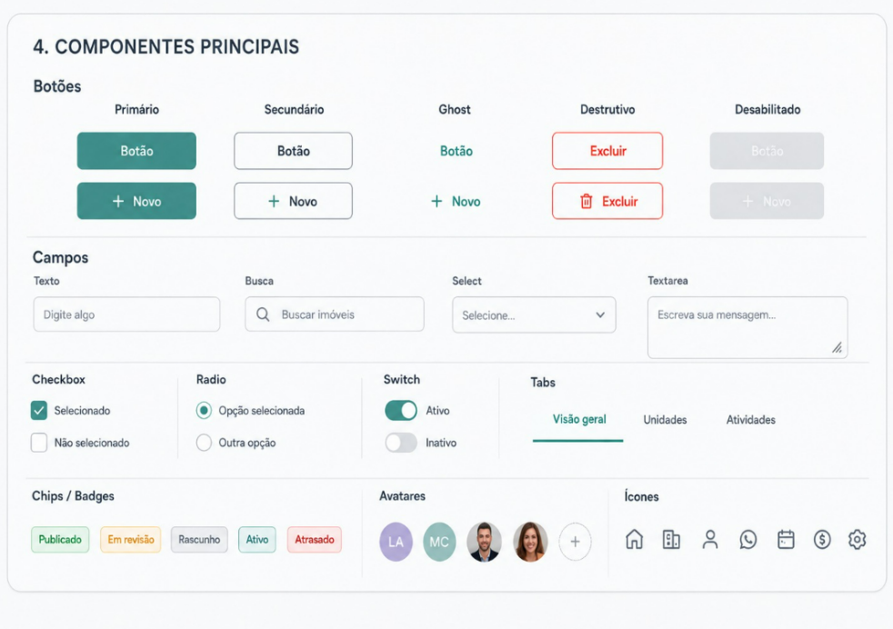

# Componentes

## Botões

| Variante | Aparência | Quando usar |
| --- | --- | --- |
| Primário | Fundo `#4F8A86`, texto branco | Ação principal da tela — uma por contexto |
| Secundário | Fundo branco, borda `#E4E7EB` | Ação de apoio |
| Ghost | Sem fundo nem borda, texto `#4F8A86` | Ação terciária, dentro de listas |
| Destrutivo | Borda e texto `#DC2626` | Excluir, cancelar de forma irreversível |
| Desabilitado | Cinza, sem interação | Ação indisponível no momento |

Cada variante aceita ícone à esquerda do rótulo (ex.: `+ Novo`, `🗑 Excluir`).

## Campos

| Campo | Observação |
| --- | --- |
| Texto | Placeholder descreve o conteúdo esperado |
| Busca | Ícone de lupa à esquerda |
| Select | Chevron à direita |
| Textarea | Redimensionável pelo canto |

Rótulo acima do campo em estilo **Label** (14/20 Medium).

## Seleção

- **Checkbox** — múltipla escolha; marcado usa `#4F8A86`.
- **Radio** — escolha única dentro de um grupo.
- **Switch** — liga/desliga com efeito imediato, sem precisar salvar.
- **Tabs** — troca de visão dentro da mesma página; a ativa recebe sublinhado `#4F8A86`.

## Chips / Badges

| Chip | Cor |
| --- | --- |
| Publicado | Sucesso |
| Em revisão | Aviso |
| Rascunho | Neutra |
| Ativo | Marca |
| Atrasado | Erro |

## Avatares

Foto quando existir; senão, iniciais sobre fundo colorido. O `+N` fecha grupos
com mais pessoas do que cabe exibir.

## Ícones

Traço linear e uniforme. Conjunto base: Home, Imóveis, Contatos, WhatsApp,
Agenda, Financeiro, Configurações.

<figure markdown>
  
  <figcaption>Botões, campos, seleção, chips, avatares e ícones</figcaption>
</figure>
