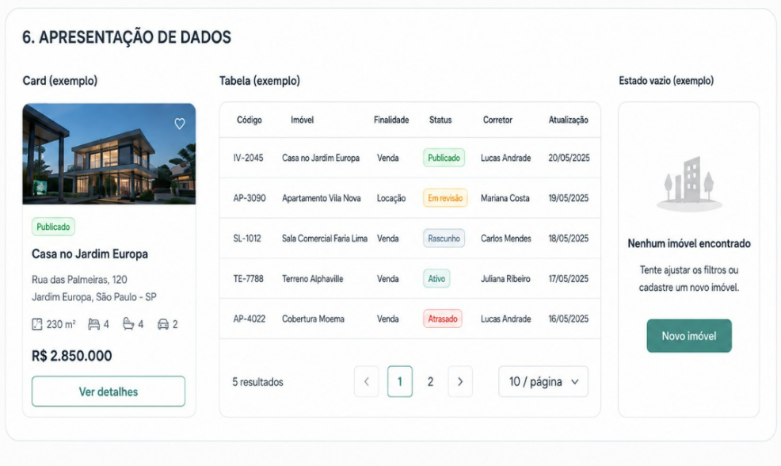

# Apresentação de dados

## Card

Para visualização de imóveis. De cima para baixo: imagem com botão de favoritar,
chip de status, título, endereço, atributos (área, quartos, banheiros, vagas),
preço em destaque e botão de ação.

## Tabela

Para listas longas e comparação. Cabeçalho em **Label**, fundo `#FAFCFD`.

| Coluna | Conteúdo |
| --- | --- |
| Código | Identificador do imóvel (ex.: `IV-2045`) |
| Imóvel | Nome ou descrição curta |
| Finalidade | Venda ou Locação |
| Status | Chip colorido |
| Corretor | Responsável |
| Atualização | Data da última alteração |

Rodapé com total de resultados, paginação e seletor de itens por página.

## Estado vazio

Sempre que uma lista volta sem resultados: ilustração discreta, título
(*"Nenhum imóvel encontrado"*), uma linha de orientação e um botão com a saída
mais provável (*"Novo imóvel"*).

Estado vazio nunca é uma tela em branco.

<figure markdown>
  
  <figcaption>Card, tabela e estado vazio</figcaption>
</figure>
