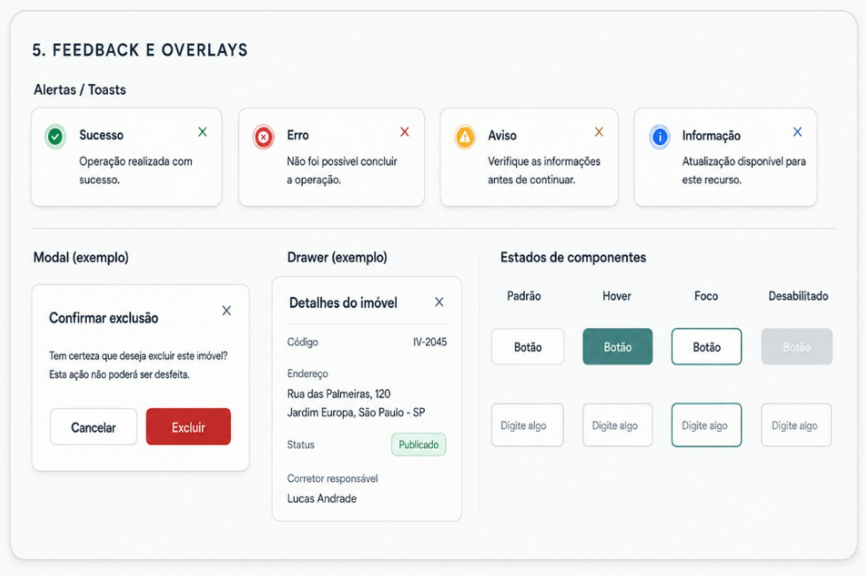

# Feedback e overlays

## Alertas / Toasts

Fundo branco, ícone colorido à esquerda, botão de fechar à direita.

| Tipo | Cor | Exemplo |
| --- | --- | --- |
| Sucesso | `#16A34A` | Operação realizada com sucesso. |
| Erro | `#DC2626` | Não foi possível concluir a operação. |
| Aviso | `#F59E0B` | Verifique as informações antes de continuar. |
| Informação | `#2563EB` | Atualização disponível para este recurso. |

Mensagem curta, em uma ou duas linhas. Erros dizem o que houve, não só que falhou.

## Modal

Para confirmações que interrompem o fluxo. Estrutura: título, explicação da
consequência, e duas ações — a neutra (`Cancelar`) à esquerda, a decisiva à direita.

Quando a ação for irreversível, diga isso no texto:
*"Esta ação não poderá ser desfeita."*

## Drawer

Painel lateral para detalhes sem sair da listagem. Mostra os campos em pares
rótulo/valor e pode conter chips de status.

## Estados de componentes

| Estado | Tratamento |
| --- | --- |
| Padrão | Borda `#E4E7EB` |
| Hover | Preenchimento ou realce na cor da marca |
| Foco | Borda 2px `#4F8A86` |
| Desabilitado | Cinza, sem cursor de interação |

Todo componente interativo precisa dos quatro estados — foco inclusive, que é
o que garante navegação por teclado.

<figure markdown>
  
  <figcaption>Toasts, modal, drawer e estados de componentes</figcaption>
</figure>
