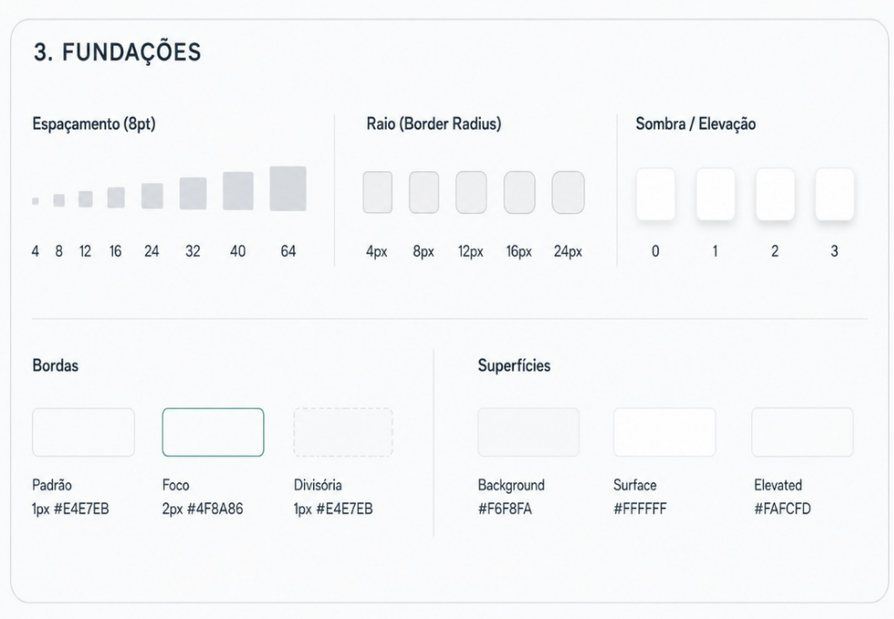

# Fundações

## Espaçamento

Escala de 8pt: **4 · 8 · 12 · 16 · 24 · 32 · 40 · 64**

| Valor | Uso típico |
| --- | --- |
| 4 / 8 | Espaço entre ícone e texto, respiro interno de chips |
| 12 / 16 | Padding de botões e campos |
| 24 / 32 | Espaço entre blocos e dentro de cards |
| 40 / 64 | Espaço entre seções da página |

## Raio

| Raio | Uso |
| --- | --- |
| 4px | Chips, badges |
| 8px | Botões, campos |
| 12px | Cards |
| 16px | Modais, drawers |
| 24px | Containers grandes |

## Elevação

| Nível | Uso |
| --- | --- |
| 0 | Superfície plana, sem sombra |
| 1 | Cards em repouso |
| 2 | Dropdowns, elementos em hover |
| 3 | Modais e drawers |

## Bordas

| Tipo | Especificação |
| --- | --- |
| Padrão | 1px `#E4E7EB` |
| Foco | 2px `#4F8A86` |
| Divisória | 1px `#E4E7EB` |

## Superfícies

| Camada | Cor | Onde aparece |
| --- | --- | --- |
| Background | `#F6F8FA` | Fundo da aplicação |
| Surface | `#FFFFFF` | Cards, modais, campos |
| Elevated | `#FAFCFD` | Cabeçalho de tabela, áreas destacadas |

<figure markdown>
  
  <figcaption>Espaçamento, raio, elevação, bordas e superfícies</figcaption>
</figure>
