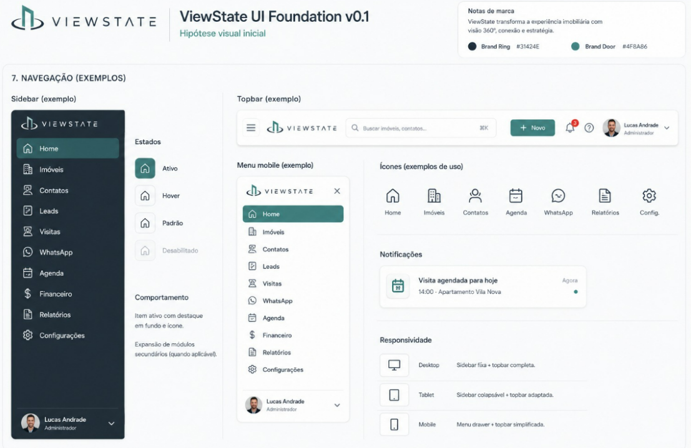

# Navegação

## Sidebar

Fundo `#31424E`, logo no topo e usuário no rodapé.

Módulos: Home · Imóveis · Contatos · Leads · Visitas · WhatsApp · Agenda ·
Financeiro · Relatórios · Configurações.

| Estado | Tratamento |
| --- | --- |
| Ativo | Fundo `#4F8A86`, ícone e texto em destaque |
| Hover | Fundo levemente mais claro |
| Padrão | Ícone e texto em neutro claro |
| Desabilitado | Opacidade reduzida |

Módulos secundários aparecem por expansão do item pai.

## Topbar

Botão de menu, logo, busca global (atalho `⌘K`), botão `+ Novo`, notificações
com contador, ajuda e menu do usuário.

## Menu mobile

Drawer sobre o conteúdo, com a mesma lista de módulos da sidebar e botão de
fechar no topo.

## Notificações

Lista com ícone, título, horário relativo ("Agora") e marcador de não lida.

## Responsividade

| Breakpoint | Comportamento |
| --- | --- |
| Desktop | Sidebar fixa + topbar completa |
| Tablet | Sidebar colapsável + topbar adaptada |
| Mobile | Menu drawer + topbar simplificada |

<figure markdown>
  
  <figcaption>Sidebar, topbar, menu mobile e responsividade</figcaption>
</figure>
