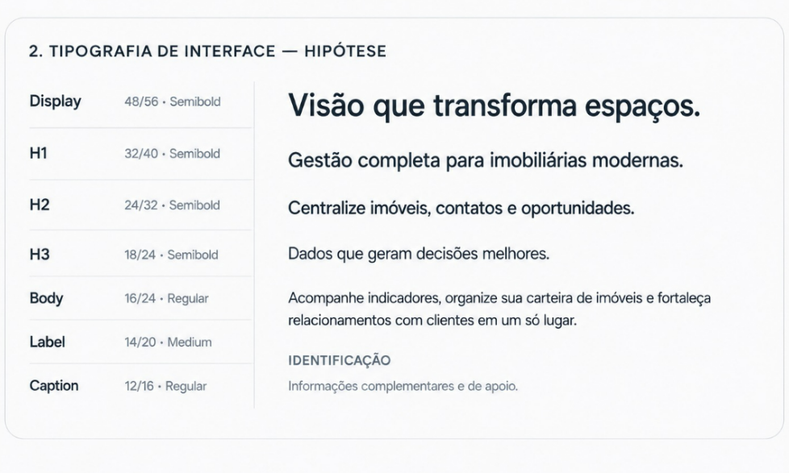

# Tipografia

Fonte sem serifa, pesos **Regular**, **Medium** e **Semibold**.

| Estilo | Tamanho / entrelinha | Peso | Uso |
| --- | --- | --- | --- |
| Display | 48 / 56 | Semibold | Chamada principal de páginas de destaque |
| H1 | 32 / 40 | Semibold | Título da página |
| H2 | 24 / 32 | Semibold | Seção |
| H3 | 18 / 24 | Semibold | Subseção, título de card |
| Body | 16 / 24 | Regular | Texto corrido |
| Label | 14 / 20 | Medium | Rótulo de campo, cabeçalho de tabela |
| Caption | 12 / 16 | Regular | Apoio, legenda, texto auxiliar |

## Regras

- Um Display por tela, no máximo.
- Títulos em **Text Primary** (`#1F2933`); apoio em **Text Secondary** (`#64748B`).
- Caption e Label em caixa normal; `IDENTIFICAÇÃO` em caixa alta só para rótulos curtos de seção.
- Não pule níveis de título (H1 → H3).

<figure markdown>
  
  <figcaption>Escala tipográfica — UI Foundation v0.1</figcaption>
</figure>
