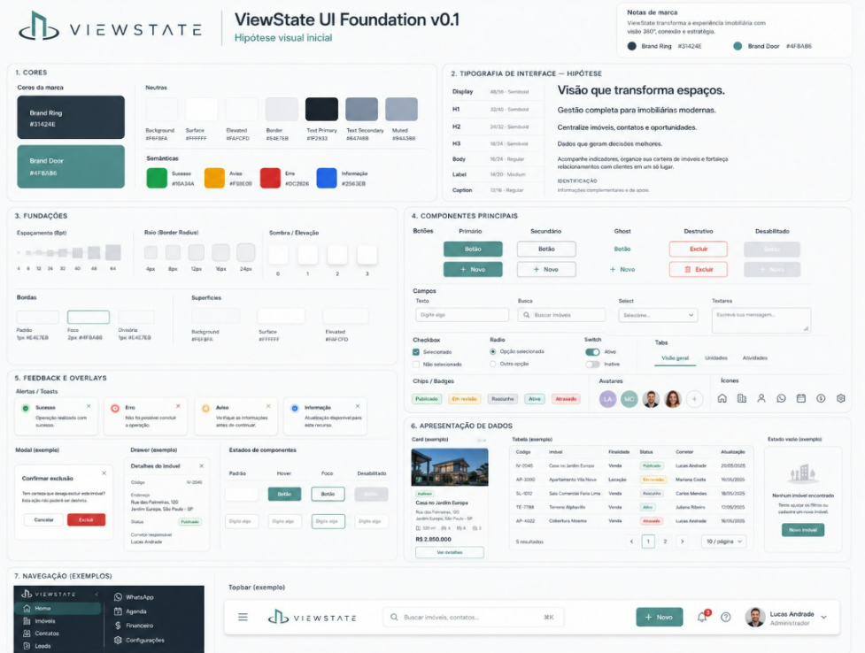

# ViewState

<figure markdown>
  { width="300" }
  <figcaption>Visão que transforma espaços.</figcaption>
</figure>

ViewState é uma plataforma de gestão para imobiliárias modernas: centraliza
imóveis, contatos e oportunidades em um só lugar, com indicadores que apoiam
decisões e relacionamento com clientes.

Esta documentação reúne a **identidade visual** e o **design system** do produto.

!!! info "UI Foundation v0.1 — hipótese visual"
    O design system abaixo é a primeira hipótese visual. Serve como base de
    trabalho e deve evoluir conforme as telas reais forem construídas.

## Seções

| Seção | O que tem lá |
| --- | --- |
| [Logo](marca/logo.md) | Símbolo, conceito, variações e arquivos |
| [Cores](marca/cores.md) | Paleta da marca, neutras e semânticas |
| [Tipografia](design-system/tipografia.md) | Escala de textos da interface |
| [Fundações](design-system/fundacoes.md) | Espaçamento, raio, elevação, bordas e superfícies |
| [Componentes](design-system/componentes.md) | Botões, campos, seleção, chips, avatares e ícones |
| [Feedback e overlays](design-system/feedback.md) | Alertas, modal, drawer e estados |
| [Apresentação de dados](design-system/dados.md) | Card, tabela e estado vazio |
| [Navegação](design-system/navegacao.md) | Sidebar, topbar, menu mobile e responsividade |

## Visão geral

<figure markdown>
  
  <figcaption>ViewState UI Foundation v0.1 — board completo</figcaption>
</figure>
