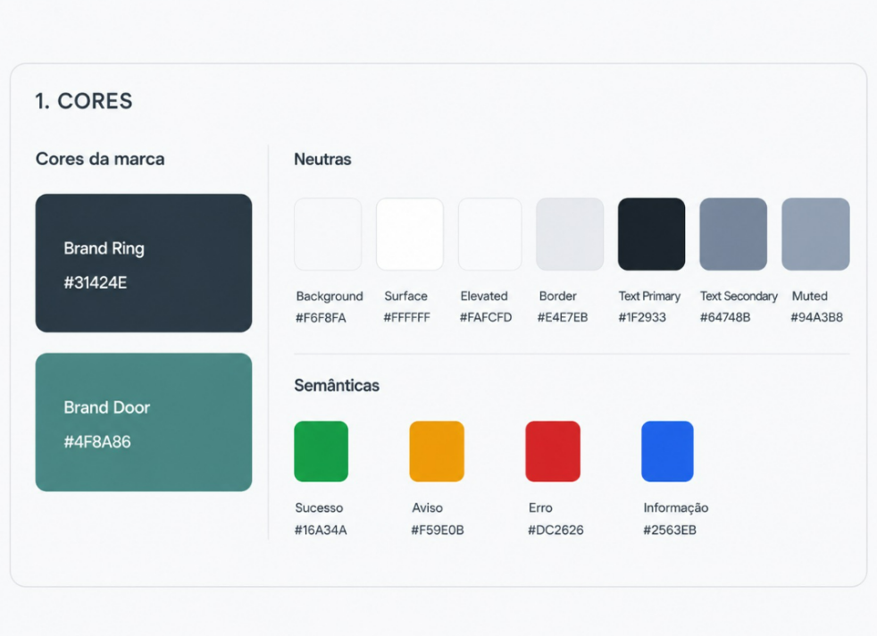

# Cores

## Cores da marca

<div class="vs-paleta" markdown>
<div class="vs-cor"><i style="background:#31424E"></i><b>Brand Ring</b><code>#31424E</code></div>
<div class="vs-cor"><i style="background:#4F8A86"></i><b>Brand Door</b><code>#4F8A86</code></div>
</div>

**Brand Ring** é a cor de base: cabeçalhos, sidebar, textos de destaque.
**Brand Door** é a cor de ação: botões primários, links, estados ativos e foco.

## Neutras

<div class="vs-paleta" markdown>
<div class="vs-cor"><i style="background:#F6F8FA"></i><b>Background</b><code>#F6F8FA</code></div>
<div class="vs-cor"><i style="background:#FFFFFF"></i><b>Surface</b><code>#FFFFFF</code></div>
<div class="vs-cor"><i style="background:#FAFCFD"></i><b>Elevated</b><code>#FAFCFD</code></div>
<div class="vs-cor"><i style="background:#E4E7EB"></i><b>Border</b><code>#E4E7EB</code></div>
<div class="vs-cor"><i style="background:#1F2933"></i><b>Text Primary</b><code>#1F2933</code></div>
<div class="vs-cor"><i style="background:#64748B"></i><b>Text Secondary</b><code>#64748B</code></div>
<div class="vs-cor"><i style="background:#94A3B8"></i><b>Muted</b><code>#94A3B8</code></div>
</div>

## Semânticas

<div class="vs-paleta" markdown>
<div class="vs-cor"><i style="background:#16A34A"></i><b>Sucesso</b><code>#16A34A</code></div>
<div class="vs-cor"><i style="background:#F59E0B"></i><b>Aviso</b><code>#F59E0B</code></div>
<div class="vs-cor"><i style="background:#DC2626"></i><b>Erro</b><code>#DC2626</code></div>
<div class="vs-cor"><i style="background:#2563EB"></i><b>Informação</b><code>#2563EB</code></div>
</div>

Use as semânticas só para comunicar estado — nunca como cor decorativa.

## Tokens

```css
:root {
  /* Marca */
  --vs-ring:   #31424E;
  --vs-door:   #4F8A86;

  /* Neutras */
  --vs-background:     #F6F8FA;
  --vs-surface:        #FFFFFF;
  --vs-elevated:       #FAFCFD;
  --vs-border:         #E4E7EB;
  --vs-text-primary:   #1F2933;
  --vs-text-secondary: #64748B;
  --vs-muted:          #94A3B8;

  /* Semânticas */
  --vs-sucesso: #16A34A;
  --vs-aviso:   #F59E0B;
  --vs-erro:    #DC2626;
  --vs-info:    #2563EB;
}
```

<figure markdown>
  
  <figcaption>Paleta completa — UI Foundation v0.1</figcaption>
</figure>
