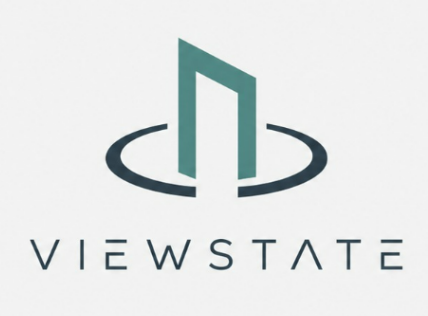
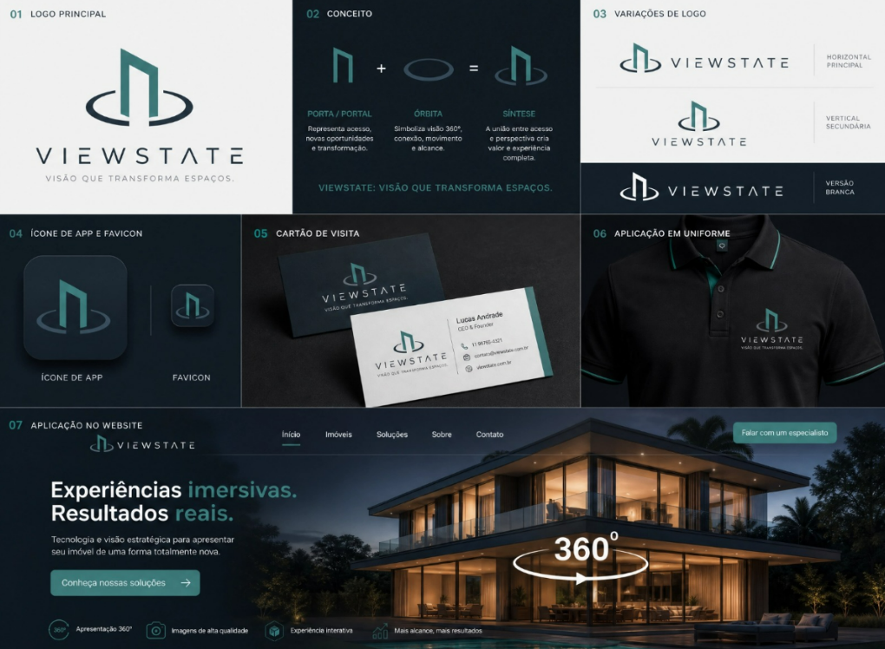

# Logo

<figure markdown>
  { width="320" }
</figure>

## Conceito

O símbolo une duas formas:

| Elemento | Significado |
| --- | --- |
| **Porta / portal** | Acesso, novas oportunidades e transformação |
| **Órbita** | Visão 360°, conexão, movimento e alcance |
| **Síntese** | Acesso + perspectiva = experiência completa |

A assinatura da marca é **"Visão que transforma espaços."**

## Variações

| Variação | Uso |
| --- | --- |
| Horizontal | Principal — cabeçalhos, topbar, documentos |
| Vertical | Secundária — quando há pouco espaço horizontal |
| Versão branca | Fundos escuros |
| Símbolo isolado | Ícone de app, favicon, avatar |

<figure markdown>
  
  <figcaption>Logo principal, conceito, variações e aplicações</figcaption>
</figure>

## Arquivos

| Arquivo | Para quê |
| --- | --- |
| [`logo-horizontal.png`](../assets/marca/logo-horizontal.png) | Assinatura horizontal |
| [`logo-vertical.png`](../assets/marca/logo-vertical.png) | Assinatura vertical |
| [`simbolo-transparente.png`](../assets/marca/simbolo-transparente.png) | Símbolo, fundo transparente, para fundos claros |
| [`simbolo-claro.png`](../assets/marca/simbolo-claro.png) | Símbolo com anel branco, para fundos escuros |
| [`favicon.png`](../assets/marca/favicon.png) | Favicon e ícone de app (180×180) |

Todos ficam em [`docs/assets/marca/`](https://github.com/ViewState360/viewstate-docs/tree/main/docs/assets/marca).

## Cuidados

- Não distorça nem rotacione o símbolo.
- Não troque as cores da marca por outras.
- Mantenha um respiro ao redor equivalente à largura do anel.
- Em fundo escuro, use a versão de anel branco.
